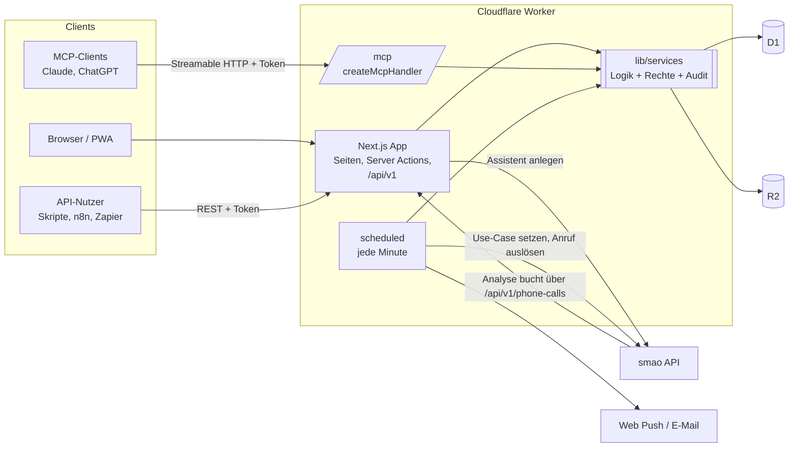
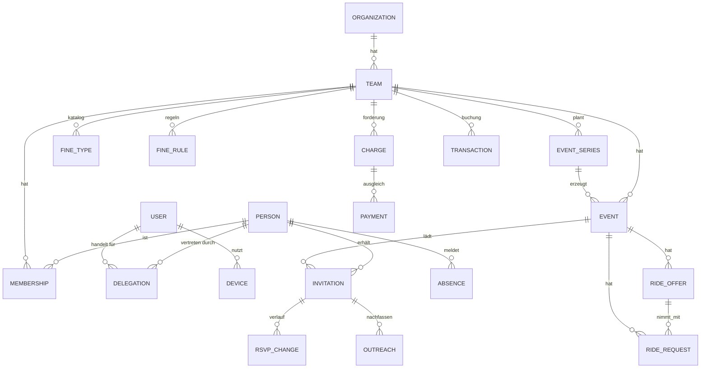
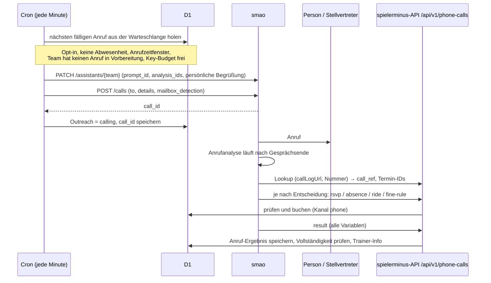

# spielerminus – Konzept

> Arbeitstitel. Ziel: der Funktionsumfang von SpielerPlus, nur ohne Abo-Schranken, deutlich schneller als Web-App, vollständig per API und MCP nutzbar und mit dem smao-Telefonassistenten als Nachfass-Kanal. Der Einstieg soll so einfach wie möglich sein.

Stand: 09.11.2026 · Status: Entwurf zur Abstimmung · Version 2 (Next.js auf Cloudflare, vereinfachte Architektur, Onboarding)

---

## 1. Analyse SpielerPlus

### 1.1 Produkt in Kürze

- Anbieter: SPM Sportplatz Media GmbH, Hamburg. Im DACH-Raum heißt das Produkt SpielerPlus, international TeamPlus.
- Plattformen: iOS, Android und eine Web-App.
- Zielgruppen: Trainer, Teammanager, Spieler, Eltern, Betreuer, Kassenwarte und Vereine.
- Geld verdient SpielerPlus mit Werbung im Free-Tarif und mit Premium-Abos pro Team bzw. Verein (Mengenrabatt). Dazu kommen Plattform-Extras wie „Benefits“, die wir weglassen.
- Eine öffentliche API gibt es nicht. Integrationen beschränken sich auf ein Kalender-Abo (iCal) und den Import von Spielplänen (CSV/XLSX/ICS, Fußball-Spielplan-Import).

### 1.2 Funktionsinventar

| Bereich | Funktionen in SpielerPlus |
|---|---|
| **Termine** | Training, Spiel, Turnier, Event; Serientermine (verkürzen, einzelne löschen); Einzeltrainings; Gruppen innerhalb eines Termins; Spielplan-Import (CSV/XLSX, ICS-URL, Fußball-Import) |
| **Zu-/Absagen** | Zusage/Absage per Klick; Modus „müssen zusagen“ (Standard) oder „müssen absagen“ (alle stehen zunächst auf zugesagt); Frist „zu-/absagen bis“; Zu-/Absagen verbergen; Trainer-Zusage abschaltbar; Status „unentschuldigt fehlend“; Verlauf der Zu-/Absagen (Premium) |
| **Erinnerungen** | Automatische Pushes: die erste geht an *alle* Mitglieder, danach 4 Pushes vor der Frist (z. B. 6/5/4/3 h vorher); E-Mail und Push lassen sich einzeln abschalten |
| **Abwesenheiten** | Geplante Abwesenheiten eintragen (Urlaub, Krankheit) |
| **Team** | Profile, Einladung per Link oder Code, inaktiv setzen, Spieler in ein anderes Team kopieren, Admin/Trainer benennen, Rollen und Rechte (eigene Rollen nur in Premium), Gastspieler (Premium), Teamdaten mit Logo und Foto |
| **Stellvertreter** | Eltern- und Ersatzkonten; mehrere Personen mit einem Login verwalten; getrennt lebende Eltern |
| **Teamkasse** | Transaktionen (Einnahmen/Ausgaben, Filter), Beiträge (anlegen, bearbeiten, archivieren), Strafenkatalog, Strafe vergeben (mehrere Spieler, Datum, Push an die Betroffenen), Strafe zurücknehmen, Kasse zurücksetzen |
| **Fahrgemeinschaften** | Mitfahrgelegenheit anbieten oder suchen, pro Termin |
| **Aufstellung** | Aufstellungen und Vorlagen |
| **Statistik** | Trainingsbeteiligung, Tore usw. |
| **Spielbericht** | Ergebnis, Gegnerlogo |
| **Kommunikation** | Team-Chat, News und „wichtige News“ auf der Startseite, Umfragen/Abstimmungen, Fotos |
| **TeamCloud** | Dokumente im Team- und im persönlichen Bereich (1 GB nur in Premium) |
| **Kalender** | Kalender-Abo (Premium) |
| **Export** | PDF-Export und Druck (Premium) |
| **Sonstiges** | Mehr als 10 Sprachen, Startseiten-Bereiche ausblendbar, Sortierung nach Nachnamen, Accounts zusammenführen |

### 1.3 Abo-Schranken bei SpielerPlus (entfallen bei uns komplett)

Laut Premium-Vergleichsseite gibt es diese Funktionen nur mit Premium:

- Werbefreiheit
- Eigene Rollen und fein einstellbare Rollenrechte
- Gastspieler
- Termin absagen und das Team benachrichtigen
- Teilnehmerzahl begrenzen
- Zeitverlauf der Zu- und Absagen
- **Mehr als 30 Teammitglieder**
- Kalender abonnieren
- PDF-Export und Druck
- 1 GB TeamCloud

**Bei uns sind alle Funktionen für alle Teams freigeschaltet.** Begrenzt wird nur, wo echte Kosten entstehen: Speicherplatz bekommt eine faire Quota, und Telefonie wird nach Verbrauch abgerechnet (siehe §9).

### 1.4 Schwachstellen, die wir besser machen

1. **Erinnerungs-Spam:** Die erste Erinnerung geht auch an alle, die schon geantwortet haben, danach kommen 4 Pushes im Stundentakt. Wir erinnern nur Personen ohne Antwort und eskalieren über die Kanäle Push → E-Mail → Anruf.
2. **Keine Konsequenz nach Fristende:** Was nach der Frist passiert, ist nicht dokumentiert. Bei uns gibt es einen definierten Status „keine Rückmeldung“ und optionale Auto-Strafen.
3. **Strafen nur von Hand:** Bei uns gibt es eine Regel-Engine, zum Beispiel „unentschuldigt gefehlt → 10 €“ oder „Absage nach Frist → 5 €“.
4. **Keine API und kein Datenexport:** Bei uns gibt es eine vollständige REST-API, MCP und einen vollständigen Export (JSON/CSV). Das verhindert Lock-in.
5. **Web-App mit Werbung und Banner-Last:** Bei uns gibt es keine Werbung und keine Tracker, und die Web-App ist als installierbare PWA gebaut (§7).
6. **Antworten nur mit Login:** Bei uns geht das per Ein-Klick-Link aus Push/E-Mail (signiertes Token), per Telefon über smao und per MCP.
7. **Fahrgemeinschaften ohne Matching:** Bei uns gibt es Sitzplatz-Bilanz, Vorschläge nach Abfahrtsort und eine Fairness-Statistik („wer fährt am seltensten?“).
8. **Holpriger Einstieg:** Bei uns kommt man in einer Minute vom WhatsApp-Link zur ersten Zusage, mit geführter Homescreen-Installation (§4).

### 1.5 Performance-Vergleich (noch offen)

Die SpielerPlus-App ist nur mit Login erreichbar. Gemessen wird deshalb mit einem Testaccount: Lighthouse für Dashboard, Terminliste und Termindetail, jeweils mit 4G-Profil und Mittelklasse-Android. Die Ergebnisse kommen in `docs/benchmark.md` und bilden die Messlatte für §7.

---

## 2. Produktprinzipien

1. **Einfach zuerst:** in der Technik so wenig bewegliche Teile wie möglich (eine Next.js-App, eine Datenbank, ein Cron), in der Bedienung so wenige Schritte wie möglich.
2. **Ein Domänenkern, viele Kanäle:** Web-App, REST-API, MCP, Cron und smao rufen dieselben Service-Funktionen mit denselben Rechteprüfungen auf. Jede Änderung wird mit dem Kanal protokolliert, über den sie kam (`app | push | link | api | mcp | phone | system`).
3. **Keine Funktions-Schranken:** Feature-Flags gibt es nur für Rollouts, nicht für Tarife.
4. **Schnell als Feature:** Server Components, kaum Client-JavaScript, keine Drittanbieter-Skripte.
5. **DSGVO und Minderjährigenschutz von Anfang an:** Datenspeicherung in der EU, Datensparsamkeit, Eltern-Einwilligung, Opt-in für Anrufe.
6. **Mobile first, in App und CRM:** Entworfen wird zuerst für das Handy (ab 360 px Breite, Bedienung mit einer Hand, große Tap-Flächen). Desktop ist die Erweiterung, nicht umgekehrt.

---

## 3. Funktionsumfang

Legende: **=** Parität mit SpielerPlus · **+** besser oder neu

### 3.1 Organisation, Teams, Mitglieder
- **=** Verein (optional) → Teams → Mitglieder; ein Login kann in mehreren Teams sein
- **=** Einladung per Link, Code oder E-Mail; inaktiv setzen; in ein anderes Team kopieren
- **+** Jedes Team hat genau **einen Besitzer** (zunächst der Ersteller, übertragbar) und beliebig viele Admins.
- **=** Rollen: Admin, Trainer, Kassenwart, Spieler, Betreuer; **eigene Rollen mit feinen Rechten für alle**
- **+** Pflichtangaben für jeden Account: **Vorname, Nachname, E-Mail, Telefonnummer** (E.164 geprüft). Personen ohne eigenen Account (Kinder, Gäste) brauchen nur einen Namen.
- **=** Gastspieler (auch ohne Account), Personen ohne Login (vom Trainer gepflegt)
- **=** Stellvertreter: Eltern und Ersatzkonten, mehrere Personen pro Login, mehrere Erziehungsberechtigte pro Kind
- **+** Telefonnummer pro Person bzw. Stellvertreter mit Anruf-Einwilligung (für smao)
- **+** Kaderliste zeigt die Erreichbarkeit jedes Mitglieds: Push aktiv, nur E-Mail oder Anruf erlaubt
- **+** Vereinsebene: teamübergreifende Übersicht, Rechte vom Verein ans Team vererbt

### 3.2 Termine
- **=** Typen Training, Spiel, Turnier, Event, Sonstiges, dazu eigene Typen
- **=** Serien (RRULE) mit Ausnahmen, Verkürzen und Bearbeiten „nur diesen / diesen und folgende / alle“
- **=** Ort mit Karte, Treffpunkt, Treffzeit, Gegner, Heim/Auswärts
- **=** Gruppen im Termin, Nominierung (nur ausgewählte Personen eingeladen)
- **=** Termin absagen mit Benachrichtigung, Teilnehmerlimit
- **+** Warteliste mit automatischem Nachrücken samt Benachrichtigung
- **=** Import per CSV/XLSX und ICS-URL; **+** ICS-Import als laufende Synchronisation statt einmaligem Import
- **=** Kalender-Abo (iCal) pro Person und pro Team, **für alle**

### 3.3 Zu-/Absagen und Anwesenheit
- **=** Status: `offen`, `zugesagt`, `abgesagt`, optional `unsicher`; Absagegrund (Freitext oder Kategorie)
- **=** Modi: „müssen zusagen“ oder „müssen absagen“; Frist; Antworten für Mitglieder verbergen
- **=** Tatsächliche Anwesenheit getrennt von der Zusage: `anwesend`, `verspätet`, `entschuldigt`, `unentschuldigt`
- **=** Vollständiger Verlauf (wer, wann, über welchen Kanal), **für alle**
- **+** Standardantwort pro Serie („Dienstags immer dabei“), jederzeit überschreibbar
- **+** Ein-Klick-Antwort aus Push (Buttons, §3.5) und E-Mail ohne Login
- **+** Nach Fristende: Status `keine Rückmeldung`, Trainer-Übersicht, optionale Auto-Strafe

### 3.4 Abwesenheiten
- **=** Zeitraum und Grund (Urlaub, Krankheit, Verletzung, Sonstiges)
- **+** Wirkt automatisch als Absage auf alle betroffenen Termine, auch auf später angelegte; keine Erinnerungen und keine Anrufe für diese Termine

### 3.5 Erinnerungen und Benachrichtigungen
- **+** Konfigurierbare Eskalationsleiter pro Team und Termintyp. Sie gilt **nur für Personen mit Status „offen“**:

| Stufe | Standard | Kanal |
|---|---|---|
| Einladung | beim Anlegen (bei Serien X Tage vorher) | Push (+ E-Mail, falls kein Push) |
| Erinnerung 1 | Frist − 48 h | Push |
| Erinnerung 2 | Frist − 24 h | Push + E-Mail |
| **Anruf** | Frist − 6 h **oder** feste Uhrzeit (z. B. 18:00 am Vortag) | **smao-Anruf** (nur mit Opt-in) |
| Fristende | Frist | Status `keine Rückmeldung`, Info an Trainer, optionale Auto-Strafe |

- **+** Ruhezeiten (Standard 21–8 Uhr), Push über alle Teams gebündelt
- **=** Push (Web Push) und E-Mail; jeder Kanal pro Kategorie abschaltbar
- Wer die App nicht installiert hat und deshalb keinen Push bekommen kann (iOS), bekommt automatisch E-Mail statt Push.

- **+** **Push mit Schnellantworten:** Wichtige Benachrichtigungen haben bis zu zwei Buttons. Ein Tipp darauf speichert die Antwort im Hintergrund, ohne dass sich die App öffnet (siehe unten).

#### Push mit Schnellantworten

| Benachrichtigung | Button 1 | Button 2 |
|---|---|---|
| Erinnerung zur Rückmeldung („Training Do 19:30, noch keine Antwort von dir“) | **Zusagen** | **Absagen** (ohne Grund; der Grund lässt sich in der App ergänzen) |
| Fahrgemeinschaft vor dem Auswärtsspiel („Es fehlen 3 Plätze für Samstag“) | **Ich fahre** (freie Plätze aus dem letzten Angebot) | **Brauche Mitfahrt** |
| Nach dem Spieltag („Wie war die Fahrt nach Irgendwo?“) | **Gefahren** | **Nicht gefahren** |

- **„Gefahren“ per Button** übernimmt die zugeordneten Mitfahrenden, die berechneten km und „Erstattung“ und reicht die Fahrt ein. Eine zweite Benachrichtigung bestätigt das; ein Tipp darauf öffnet die Fahrt zum Ändern (eigene km, Notiz, Spende), solange sie noch nicht übermittelt ist.
- **Technik:** Der Service Worker verarbeitet `notificationclick` mit `event.action` und ruft `POST /api/v1/quick-actions/{token}` auf. Jeder Button trägt ein signiertes Einmal-Token, das nur für genau diese Antwort und Person gilt und nach Fristende bzw. 7 Tagen verfällt. Es funktioniert auch ohne gültige Sitzung. Kanal der Buchung ist `push`.
- **Wo die Buttons erscheinen:** Android (Chrome, Edge, Samsung Internet, Firefox) und Desktop (Chrome, Edge, Firefox). Wie viele Buttons angezeigt werden, legt das Gerät fest (`Notification.maxActions`); wir planen mit höchstens zwei.
- **iPhone/iPad:** Safari zeigt bei Web-Push keine Buttons. Ein Tipp auf die Benachrichtigung öffnet die Schnellantwort-Seite `/q/{token}` mit denselben zwei großen Buttons. Sie lädt ohne Login und ohne App-Gerüst sofort. Echte Buttons auf iOS gäbe es erst mit einer nativen App-Hülle (Phase 4).
- **E-Mail:** Erinnerungs-Mails enthalten dieselben zwei Links auf `/q/{token}`.

### 3.6 Fahrgemeinschaften
- **=** Pro Termin Plätze anbieten (Fahrer, Sitzplätze, Abfahrtsort und -zeit) oder eine Mitfahrt suchen
- **+** Mitfahrende einem Fahrer zuordnen (selbst oder durch den Trainer), Sitzplatz-Bilanz pro Termin
- **+** Vorschläge nach Abfahrtsort; bei Kindern sieht die Fahrten der Stellvertreter
- **+** **Fahrer-Rangliste:** wer am häufigsten fährt (Fahrten und km pro Saison), als Anerkennung für die Fahrer
- **+** Hinweis bei Auswärtsspielen ohne genug Plätze
- **+** Nach dem Spieltag fragt ein Popup den Fahrer, ob und mit wie vielen er gefahren ist, und erfasst die Fahrt für die Fahrtkostenerstattung (§3.12)
- **+** Telefonisch per smao eintragbar („Ich kann zwei mitnehmen“ / „Wir brauchen eine Mitfahrt“)

### 3.7 Teamkasse
- **=** Konto mit Transaktionen (Einnahme/Ausgabe, Kategorie, Beleg-Upload), Filter und Export
- **=** Beiträge: Betrag, Intervall (einmalig, monatlich, saisonal), Zuweisung an Personen oder Rollen, archivieren
- **=** Strafenkatalog: Name, Betrag oder Sachstrafe („Kasten Bier“), Beschreibung
- **=** Strafe vergeben (mehrere Personen, Datum, Termin-Bezug), Push an die Betroffenen
- **+** **Strafen bleiben immer erhalten und können nur gestrichen werden.** Es gibt kein Löschen, weder in der UI noch in der API, MCP oder Datenbanklogik. Streichen setzt den Status `gestrichen` mit Grund, Person und Zeitpunkt. Gestrichene Strafen bleiben in der Historie sichtbar und zählen nicht zum Saldo. Der Betrag ist nach dem Anlegen unveränderlich; eine Korrektur heißt streichen und neu anlegen.
- **+** Offene-Posten-Logik: Jede Strafe und jeder Beitrag ist eine Forderung mit Status `offen | bezahlt | gestrichen`, mit Teilzahlungen und Saldo pro Person
- **+** **Refinanzierung über Strafen (später):** In den Admin-Einstellungen wird eine Bezahlmethode angebunden, über die offene Strafen abgerechnet werden. Grundlage ist die vollständige, unveränderliche Strafenhistorie. Für das Einsammeln von Geld im Namen von Teams braucht es einen Zahlungsanbieter mit Marktplatz-Modell (z. B. Stripe Connect), weil das sonst unter das Zahlungsdiensteaufsichtsgesetz (ZAG) fallen kann.
- **+** **Auto-Strafen-Regeln:** Auslöser (unentschuldigt gefehlt, Absage nach Frist, keine Rückmeldung, zu spät gekommen, telefonisch nachgefasst) → Katalogeintrag. Wahlweise automatisch buchen oder als Vorschlag zur Freigabe durch den Kassenwart.
- **+** Bezahlen ohne eigene Zahlungsabwicklung: EPC-QR-Code (GiroCode) auf das Kassen-IBAN mit Verwendungszweck, PayPal.me-Link; der Kassenwart bestätigt den Eingang
- **+** Saison-Abschluss statt „Kasse zurücksetzen“: Salden werden archiviert und vorgetragen

### 3.8 Kommunikation
- **=** Team-Chat, Gruppen-Chats, Direktnachrichten; Bilder; Moderation
- **=** News mit „wichtig“ (angepinnt), Kommentare
- **=** Umfragen: Einfach- oder Mehrfachauswahl, anonym, Frist, Ergebnis sichtbar ab …
- **+** Lesebestätigung für wichtige News, Nachfassen bei Ungelesenen

### 3.9 Sportliches
- **=** Aufstellungen mit Formation und Vorlagen
- **=** Spielbericht: Ergebnis, Torschützen, Vorlagen, Karten, Einsatzminuten, Gegnerlogo
- **=** Statistiken: Trainingsbeteiligung, Anwesenheitsquote, Tore usw.; Export
- **+** Dienste und Aufgaben (Trikots waschen, Getränke, Kuchen, Platzdienst) mit fairer Rotation und Tausch

### 3.10 Dateien
- **=** TeamCloud mit Ordnern sowie persönlicher Bereich; **für alle**, Quota z. B. 2 GB pro Team

### 3.11 Export und Datenhoheit
- **=** PDF-Export und Druck (Anwesenheitsliste, Kasse, Kader), **für alle**
- **+** Vollständiger Team-Export (JSON/CSV) und DSGVO-Auskunft per Klick
- **+** Import aus SpielerPlus: Kader per CSV, Termine per ICS-Abo des SpielerPlus-Kalenders und Strafenkatalog per CSV-Vorlage

### 3.12 Fahrten und Fahrtkostenerstattung

**Ziel:** Das Papierformular für die Fahrtkostenerstattung ablösen. Fahrer geben ihre Fahrten in wenigen Sekunden auf dem Handy ab, der Verein bekommt sie gesammelt und vollständig per E-Mail und kann einfach erstatten.

**Rückfrage nach dem Spieltag (Popup):**
- **Auslöser:** Ein Termin eines erstattungsfähigen Typs (Standard: Spiel und Turnier, im Team einstellbar) ist seit einer Stunde vorbei, und die Person war dort als Fahrer eingetragen.
- Beim nächsten Öffnen der App erscheint das Popup, zusätzlich kommt ein Push („Wie war die Fahrt zum Spiel beim FC Beispiel?“). Es bleibt offen, bis es beantwortet ist; „Später“ schiebt es auf den nächsten App-Start.
- Die Schritte:
  1. **„Bist du gefahren?“** Ja / Nein. Bei Nein wird die Fahrt als „nicht gefahren“ gespeichert, und das Popup endet.
  2. **„Wie viele Personen hast du mitgenommen?“** Vorbelegt mit der Zahl der zugeordneten Mitfahrenden; die Namen lassen sich antippen.
  3. **„Wie sollen die Kilometer ermittelt werden?“**
     - „Berechnung von spielerminus nutzen“: Abfahrtsort → Zielort (Hallenadresse), standardmäßig Hin- und Rückfahrt, mit Anzeige der berechneten km
     - „Eigene Angabe“: km-Feld
     - Dazu ein Notizfeld für Umstände (z. B. „Umweg, Mitspielerin in Neustadt abgeholt“); bei eigener Angabe wird es empfohlen.
  4. **„Erstattung beantragen oder dem Verein spenden?“**
  5. **Zusammenfassung:** Datum, Anlass, Strecke, km, aktueller km-Satz, Betrag und der Hinweis zur Erstattung (siehe unten). Dann „Absenden“.

**Fahrt selbst eintragen:** In „Meine Fahrten“ gibt es „Fahrt eintragen“ mit demselben Formular. Die Fahrt kann mit einem Termin verknüpft sein oder frei mit Datum, Start, Ziel und Anlass erfasst werden.

**„Meine Fahrten“ (Übersicht pro Nutzer):**
- Oben der **aktuelle km-Satz** in Cent, z. B. „Aktuell 30 ct pro km, festgelegt vom VC Deshalb“, und die Summe der Saison
- Pro Fahrt: Datum, Anlass, Strecke, **km**, **Betrag** und Status (`eingereicht`, `übermittelt`, `gespendet`, `nicht gefahren`)
- Dauerhafter Hinweis: „Die Beträge sind eine Berechnung von spielerminus. Die tatsächliche Erstattung erfolgt durch deinen Verein und kann abweichen.“
- Alle Fahrten eines Nutzers bleiben gespeichert und sind exportierbar.

**Einstellungen des Vereins bzw. Teams** (Recht `finance.write`):
- km-Satz in Cent mit Gültigkeitsdatum; frühere Sätze bleiben als Historie erhalten
- Empfänger-E-Mail-Adresse für die Abgabe sowie der Versandrhythmus (z. B. monatlich oder auf Knopfdruck)
- erstattungsfähige Termintypen, Standard „Hin- und Rückfahrt“, Spendenoption an/aus

**Berechnung:**
- Die Strecke berechnet ein Routing-Dienst zwischen Abfahrtsort (aus dem Fahrangebot bzw. der Heimatadresse im Profil) und dem Ort des Termins. Vorschlag: OpenRouteService (OpenStreetMap-basiert, Server in Deutschland, kostenloser Tarif). Ergebnisse werden pro Adresspaar zwischengespeichert.
- Betrag = km × Satz. Der Satz wird beim Absenden eingefroren, spätere Satzänderungen ändern alte Fahrten nicht.

**Abgabe an den Verein:**
- Die Fahrten gehen per E-Mail an die eingestellte Adresse. Das genaue Format wird noch festgelegt (Vorschlag: Sammel-Mail pro Zeitraum mit PDF und CSV).
- Jede Position enthält Fahrer, Datum, Anlass, Strecke, km (berechnet bzw. eigene Angabe), Mitfahrende, Notiz, Satz, Betrag und Erstattung oder Spende.
- Danach ist der Status `übermittelt`. Wie bei Strafen wird nichts gelöscht: Eine Korrektur heißt zurückziehen und neu einreichen.

**Spende an den Verein:** Der Fahrer bestätigt ausdrücklich, auf die Erstattung zugunsten des Vereins zu verzichten. Das wird mit Zeitpunkt gespeichert und in der Abgabe gesondert markiert, damit der Verein eine Zuwendungsbestätigung (Aufwandsspende) ausstellen kann. Ob die steuerlichen Voraussetzungen erfüllt sind (z. B. Erstattungsanspruch laut Satzung oder Vorstandsbeschluss), liegt beim Verein.

### 3.13 Nutzung, Kosten und Plattformgebühren

spielerminus soll sich später über einen **Anteil an Fahrtkostenerstattungen und Strafen** sowie über **Anrufminuten** finanzieren. Die Beträge stehen bewusst noch nicht fest, die Architektur berücksichtigt sie aber von Anfang an:

- **Preisplan als versionierte Konfiguration** (`price_plan`): Anrufpreis in Cent pro Minute, Gebühr auf Strafen und Gebühr auf Erstattungen (jeweils in Basispunkten), gültig ab. Es gibt einen Standardplan, ein Team oder Verein kann einen eigenen bekommen. Zum Start stehen alle Werte auf 0.
- **Nutzungsjournal** (`usage_event`, nur anhängend, nie geändert): Anrufminuten pro Anruf, Strafe angelegt / gestrichen / bezahlt, Fahrt eingereicht / gespendet. Jeder Eintrag hat Team, Periode, Menge, Grundbetrag und Bezug zur Quelle.
- **Abrechnungsperiode** (Standard: Kalendermonat): Während der Periode werden die Gebühren als Vorschau aus Journal und Preisplan berechnet, beim Abschluss werden sie eingefroren. Gestrichene Strafen zählen nicht.
- **Ansicht „Nutzung & Kosten“** für Besitzer und Admins: aktuelle Periode mit Anrufen und Minuten, Strafensumme, Erstattungssumme, Gebühr je Position und Gesamtsumme; frühere Perioden darunter.
- **Anrufminuten:** Am einfachsten übergibt der Result-Node die Gesprächsdauer. Kann die Analyse das nicht, gleicht ein täglicher Job die Minuten pro Assistent über `GET /calls?assistant_id=…` ab; der Config-Key bräuchte dafür „Anrufprotokolle: Lesen“. Das klären wir beim Testanruf.
- Bezahlt werden die Gebühren später über die Bezahlmethode in den Admin-Einstellungen (§3.7).

---

## 4. Einfacher Einstieg (Onboarding)

**Ziele:**
- Ein Trainer hat in **2 Minuten** ein Team mit erstem Training und einen Einladungslink.
- Ein Mitglied kommt in **1 Minute** vom WhatsApp-Link zur ersten Zusage.
- Danach ist die App auf dem Homescreen installiert und Push ist aktiv.

### 4.1 Anmeldung ohne Passwort

- Standard ist ein **6-stelliger E-Mail-Code**, kein Magic Link. Einladungslinks werden meist in WhatsApp geöffnet, also im In-App-Browser. Ein Magic Link würde im Mail-Programm oder einem anderen Browser aufgehen, und die Sitzung landete im falschen Browser. Einen Code tippt man dort ein, wo man gerade ist.
- Optional lässt sich danach ein Passkey anlegen (Face ID/Fingerabdruck), damit man sich auf weiteren Geräten schneller anmelden kann.
- Konten werden erst beim ersten Login erstellt. Vorher braucht es keine Registrierung.
- Beim ersten Login werden die Pflichtangaben abgefragt: Vorname, Nachname und Telefonnummer (die E-Mail ist durch den Code schon bestätigt). Die Telefonnummer allein ist noch keine Einwilligung in Anrufe.

### 4.2 Trainer: Team anlegen

1. E-Mail eingeben, Code bestätigen, Vorname, Nachname und Telefonnummer angeben. Wer das Team anlegt, ist sein Besitzer.
2. Teamname, Sportart und „Jugendteam?“ angeben. Die Sportart setzt passende Termintypen und eine optionale Vorlage für den Strafenkatalog. Ein Jugendteam schaltet den Eltern-Modus ein.
3. Erstes Training anlegen: Wochentag(e), Uhrzeit und Ort. Daraus entsteht direkt eine Serie.
4. Einladen: Teilen-Button (Web Share API, also direkt WhatsApp), Link kopieren oder QR-Code zum Zeigen im Training. Die Link-Vorschau in WhatsApp zeigt Teamname, Logo und nächsten Termin (Open-Graph-Bild).
5. Auf der Startseite steht danach eine Checkliste „Erste Schritte“: Kader vorab anlegen, Kasse einrichten, Erinnerungen prüfen, smao-Anrufe aktivieren. Sie ist optional und lässt sich ausblenden.

### 4.3 Mitglied: über den Einladungslink beitreten

1. Link öffnen. Ohne Login sind Teamname, Logo und der nächste Termin zu sehen.
2. „Wer bist du?“: Den eigenen Namen aus dem Kader wählen, falls der Trainer ihn schon angelegt hat, sonst neu eintragen. Bei Jugendteams steht dort „Ich bin Elternteil von …“, mit mehreren Kindern möglich.
3. E-Mail eingeben und Code bestätigen, dann Vorname, Nachname und Telefonnummer (bei bekannten Kader-Einträgen vorausgefüllt).
4. **Sofort die erste Zusage** für den nächsten Termin abgeben.
5. **Homescreen-Anleitung** (§4.4), danach die Push-Erlaubnis.
6. Optional die Einwilligung für die schon erfasste Telefonnummer: „Darf dich der Team-Assistent anrufen, wenn du vergisst zuzusagen?“

### 4.4 Anleitung „Zum Home-Bildschirm hinzufügen“

**Wann sie erscheint:** bei neuen Anmeldungen direkt nach der ersten Zusage, weil die Motivation dann am größten ist. Sie erscheint nicht, wenn die App bereits installiert läuft. Erkannt wird das an `display-mode: standalone` bzw. `navigator.standalone` auf iOS.

**Warum sie wichtig ist:** iOS stellt Web-Push nur an Web-Apps zu, die auf dem Home-Bildschirm liegen. Ohne Installation bleiben auf dem iPhone nur E-Mail und Anruf als Erinnerungskanäle.

**Plattformerkennung:** Die Anleitung erkennt das Gerät und zeigt nur die passenden Schritte, jeweils mit einer kurzen illustrierten Abfolge (eigene Grafiken oder ein kurzes Video):

| Umgebung | Anleitung |
|---|---|
| **In-App-Browser** (WhatsApp, Instagram, Facebook, Telegram) | Zuerst „Im Browser öffnen“: über das Menü (⋮ bzw. …) „In Safari/Chrome öffnen“, alternativ mit dem Button „Link kopieren“. Dank Login per Code geht es dort direkt weiter. |
| **iPhone/iPad – Safari** | Teilen-Symbol (in neueren iOS-Versionen ggf. hinter „…“) → „Zum Home-Bildschirm“ → „Hinzufügen“ |
| **iPhone/iPad – Chrome, Edge, Firefox** | Teilen-Symbol → „Zum Home-Bildschirm“ (ab iOS 16.4) |
| **Android – Chrome, Edge, Samsung Internet** | Eigener Button „App installieren“, der den nativen Installationsdialog öffnet (`beforeinstallprompt`). Fallback: Menü ⋮ → „App installieren“ bzw. „Zum Startbildschirm hinzufügen“ |
| **Android – Firefox** | Menü → „Installieren“ |
| **Desktop – Chrome, Edge** | Button „App installieren“ (`beforeinstallprompt`); nur ein dezenter Hinweis |
| **Desktop – Safari (macOS)** | Ablage → „Zum Dock hinzufügen“; nur ein dezenter Hinweis |

**Nach der Installation:** Beim ersten Start aus dem Homescreen erscheint „Benachrichtigungen aktivieren“. Die Push-Erlaubnis wird erst nach diesem Klick angefragt, weil iOS eine Nutzeraktion verlangt. Das Gerät wird mit Push-Subscription gespeichert, und der Trainer sieht im Kader, wer per Push erreichbar ist.

**Nicht nervig:** Die Anleitung lässt sich überspringen. Danach erscheint höchstens dreimal ein dezentes Banner mit „Nicht mehr anzeigen“. In den Einstellungen bleibt „App installieren“ jederzeit erreichbar.

**Technik:**
- `app/manifest.ts`: Name, Kurzname, Icons (inkl. maskable), `start_url: "/?source=pwa"`, `display: "standalone"`, Theme-Farbe
- `appleWebApp`-Metadaten und Apple-Touch-Icon
- Ein schlanker eigener Service Worker nur für Push-Empfang, Klick auf die Benachrichtigung und eine Offline-Seite. Kein großes Offline-Caching.

---

## 5. Architektur

### 5.1 Überblick

Alles läuft auf Cloudflare. **Eine Next.js-App ist das ganze Backend und Frontend**; dazu kommen D1 als Datenbank, R2 für Dateien und ein Cron Trigger für Erinnerungen und Anrufe.



### 5.2 Stack

| Schicht | Wahl | Hinweis |
|---|---|---|
| App | **Next.js** (App Router) auf **Cloudflare Workers** über `@opennextjs/cloudflare` | Server Components für die Seiten, Server Actions für Formulare |
| Worker-Einstieg | eigene `worker.ts` | leitet `/mcp` an den MCP-Handler und alles andere an Next.js weiter; dazu der `scheduled`-Handler für den Cron (OpenNext-Muster „Custom Worker“) |
| Datenbank | **D1** (SQLite) + Drizzle ORM | Standort-Hinweis Westeuropa; Geldbeträge als Integer in Cent |
| Dateien | **R2** | Logos, Belege, TeamCloud, Gegnerlogos |
| Hintergrundjobs | **Cron Trigger** (alle 5 Minuten) | prüft fällige Erinnerungs- und Anrufstufen. Cloudflare Queues erst bei echtem Bedarf |
| Auth | eigene schlanke Umsetzung auf D1 | 6-stelliger E-Mail-Code, Sessions als gehashte Tokens im Cookie; Passkeys und API-Tokens folgen (Umsetzung Phase 1: ohne Auth-Bibliothek, weniger bewegliche Teile) |
| E-Mail | Cloudflare Email Service | Login-Codes, Erinnerungen, Einladungen |
| Push | Web Push mit VAPID, signiert per Web Crypto | Worker-kompatible Bibliothek, kein Node-`crypto` |
| MCP | `createMcpHandler` aus dem Cloudflare Agents SDK | zustandslos, keine Durable Objects nötig |
| Validierung | Zod | gleiche Schemas für Formulare, API, MCP-Tools und die OpenAPI-Datei |
| Deploy | Wrangler über GitLab CI | Preview-Deployments pro Branch |

**Bewusst weggelassen bzw. verschoben, bis es echten Bedarf gibt:** eigener API-Server, Monorepo, Postgres, Job-Queue, Realtime (SSE/WebSockets; Listen aktualisieren sich beim Fokussieren der Seite), native Apps, eigener OAuth-Server, Performance-Budgets in der CI.

**Cron:** ein einziger Trigger, der jede Minute läuft (`* * * * *`). Er verschickt fällige Erinnerungen, startet Anrufe aus der Warteschlange und setzt Fristende-Status. Anrufergebnisse kommen per Webhook von smao, nicht über den Cron. Das sind rund 1.440 Aufrufe am Tag.

### 5.2a Cloudflare-Account und Abgrenzung (Stand 09.11.2026, nur lesend geprüft)

- Die Zone **spielerminus.app** ist aktiv (Plan „Free Website“) im Account „Kevin Tergast“. Wrangler ist angemeldet und hat Schreibrechte für Workers, Routes, D1, KV, Queues, Secrets Store und Email Sending, für die Zone aber nur Leserechte (DNS-Einträge sind nicht lesbar).
- Im selben Account laufen vier weitere Worker (`dreizehn`, `klockix`, `klockix-crm`, `klockix-termin`) mit zusammen drei Cron-Triggern.
- **Abgrenzung:** Alle Ressourcen heißen `spielerminus-*` (Worker, D1, R2, Secrets). Die Worker hängen nur per Custom Domain an spielerminus.app (App) und crm.spielerminus.app (Mini-CRM, §11). Account-weite Einstellungen und andere Zonen oder Worker fassen wir nicht an.
- **Plan:** Der Account hat einen Workers-Bezahlplan, der laut Vorgabe ausreicht. Die Limits des Free-Plans (100.000 Requests pro Tag für den ganzen Account, 10 ms CPU, 5 Cron-Trigger) spielen damit keine Rolle.

### 5.3 Projektstruktur

```
app/
  (marketing)/            Landingpage
  (app)/                  eingeloggter Bereich: Start, Termine, Kader, Kasse, Fahrten …
  join/[code]/            Einladung + Onboarding
  api/v1/…                REST-API (Route Handlers)
  manifest.ts             PWA-Manifest
lib/
  services/               Domänenlogik inkl. Rechteprüfung und Audit (von allem genutzt)
  db/                     Drizzle-Schema + Migrationen
  auth/                   better-auth-Konfiguration
  mcp/                    MCP-Server-Factory und Tools
  smao/                   Assistent anlegen, Use-Case setzen, Anruf auslösen
app/api/v1/phone-calls/   anrufgebundene Endpunkte für die smao-Analyse
  jobs/                   Cron-Logik (Erinnerungen, Anrufe, Fristende, Auto-Strafen)
  push/                   Web Push
public/sw.js              Service Worker (Push + Offline-Seite)
worker.ts                 Worker-Einstieg: fetch → Next.js bzw. /mcp; scheduled → lib/jobs
wrangler.jsonc
```

### 5.4 Rechte

- Rechte sind feingranular und werden an Rollen gebunden, zum Beispiel `event.create`, `event.cancel`, `rsvp.write.others`, `attendance.write`, `finance.read`, `finance.write`, `fine.assign`, `member.manage`, `role.manage`.
- Zum Start gibt es feste Standardrollen; eigene Rollen folgen in Phase 3 auf derselben Grundlage.
- Geprüft wird immer in `lib/services`, nie nur in der UI oder Route.
- Stellvertretung ist ein eigenes Konzept (Login → darf für Person X handeln) und keine Rolle.
- API-Tokens haben zusätzlich **Scopes**. Wirksam ist immer die Schnittmenge aus Nutzerrechten und Scopes.

---

## 6. Datenmodell (Kern)



Wichtige Tabellen und Felder:

- **person**: Name, `phone_e164`, `call_consent_at`, `is_minor`. Eine Person kann ohne `user` existieren.
- **user**: Login mit Pflichtfeldern `first_name`, `last_name`, `email`, `phone_e164`, dazu `onboarding_state` (Schritte erledigt, Install-Hinweis gezeigt/verworfen). **delegation**: `(user_id, person_id, kind: self|guardian|substitute)`.
- **device**: `user_id`, Plattform, `installed` (Standalone erkannt), Push-Subscription, `last_seen`.
- **team**: u. a. `owner_user_id` (genau ein Besitzer), `smao_assistant_id`, `smao_phone`.
- **membership**: Person × Team mit Rolle(n).
- **event**: `type`, `starts_at`, `ends_at`, `meet_at`, `location`, `rsvp_mode: opt_in|opt_out`, `rsvp_deadline`, `max_participants`, `responses_visible`, `status: scheduled|cancelled`, `series_id`, `external_ref` (Import).
- **invitation** (Person × Termin): `rsvp: pending|accepted|declined|maybe|no_response`, `reason`, `attendance: present|late|excused|unexcused|null`, `waitlist_pos`, `group`.
- **action_token**: signiertes Einmal-Token für Schnellantworten `(id, user_id, person_id, kind: rsvp|ride|trip, target_id, allowed_actions, expires_at, used_at)`.
- **rsvp_change**: unveränderliches Protokoll `(invitation_id, from, to, actor_user_id, channel, at)`. Daraus entsteht der „Zeitverlauf“.
- **absence**: `person_id, from, to, kind, note`.
- **ride_offer**: `driver_person_id, seats, depart_from, depart_at`. **ride_request**: `person_id, pickup_hint, offer_id?`.
- **trip** (gefahrene Fahrt, dauerhaft gespeichert): `driver_user_id, event_id?, date, purpose, from, to, round_trip, km_calculated, km_claimed, km_source: calculated|manual, passengers_count, passenger_ids, note, rate_cents (eingefroren), amount_cents, choice: reimburse|donate, donation_confirmed_at?, status: not_driven|submitted|transmitted|withdrawn, transmitted_at, created_via: popup|manual|phone`.
- **reimbursement_settings** (pro Verein/Team): `rate_cents` mit `valid_from` (Historie), `recipient_email`, `cadence`, `eligible_event_types`, `round_trip_default`, `donation_enabled`.
- **price_plan**: `call_cents_per_minute`, `fine_fee_bps`, `reimbursement_fee_bps`, `valid_from`; Zuordnung Standard / pro Team / pro Verein.
- **usage_event** (nur anhängend): `team_id, period, kind: call_minutes|fine_created|fine_voided|fine_paid|trip_submitted|trip_donated, quantity, base_amount_cents, source_ref, at`. **billing_period**: `team_id, from, to, status: open|closed, Summen je Position` (beim Abschluss eingefroren).
- **charge**: `person_id, source: fine|fee|manual, fine_type_id?, amount_cents | in_kind, status: open|paid|voided, event_id?, outreach_id?, created_via, created_by`. Dazu `voided_at`, `voided_by`, `void_reason`. Es gibt kein DELETE; Betrag und Person sind nach dem Anlegen unveränderlich.
- **fine_rule**: `trigger: unexcused_absence|late_decline|no_response|late_arrival|phone_followup`, `fine_type_id`, `mode: auto|suggest`.
- **team_settings** (JSON): Erinnerungsstufen, Ruhezeiten, `call_enabled`, Anrufzeitfenster. Am Team selbst: `smao_assistant_id`, `smao_phone`.
- **smao_usecase**: `key (rsvp_followup|ride_gap|absence_check)`, `prompt_id`, `analysis_ids`, `introduction_template`, `active`.
- **outreach**: jede Erinnerung und jeder Anruf mit Kanal, Use-Case, Status (`queued|calling|done|incomplete|no_result|failed`), `details`, Termin-Reihenfolge E1–E3, smao-Call-ID, empfangene Analyse-Variablen, `applied_at` und ausgeführten Buchungen.
- **audit_log**: alle schreibenden Aktionen mit Kanal.

---

## 7. Performance

**Ziele:** LCP unter 1,5 s auf 4G mit Mittelklasse-Android, Zusage-Klick sofort sichtbar (optimistisches Update), keine Drittanbieter-Skripte. Gemessen wird gegen SpielerPlus (§1.5).

**Maßnahmen:**
- Server Components rendern die Seiten; Client-JavaScript gibt es nur für interaktive Inseln (Zusage-Buttons, Formulare).
- Die Startseite lädt alles mit einer Abfrage-Runde: nächste Termine, offene Antworten, Saldo und News.
- Statische Assets kommen aus dem Cloudflare-Cache; Next.js `<Image>` für Logos und Fotos.
- D1-Indizes auf `(team_id, starts_at)` und `(person_id, rsvp)`. Smart Placement lässt den Worker nah an der Datenbank laufen.
- Keine Werbung, keine Tracker, Systemschrift oder selbst gehostete Schrift über `next/font`.

---

## 8. Öffentliche API

- **REST** unter `/api/v1`, umgesetzt als Next.js Route Handlers. Sie rufen dieselben `lib/services` auf wie die Web-App. Eine OpenAPI-Datei wird aus den Zod-Schemas erzeugt und unter `/api/docs` angezeigt.
- **Auth:** API-Tokens pro Nutzer mit Scopes (in den Einstellungen anlegbar). smao braucht keinen Zugang zu unserer API, weil wir nach dem Anruf selbst auswerten (§9). OAuth folgt erst, wenn Clients es verlangen (z. B. Custom Connectors in claude.ai).
- **Konventionen:** Cursor-Pagination, `Idempotency-Key` bei POST/PUT (wichtig für Telefon-Retries), einheitliches Fehlerformat (RFC 9457).
- **Webhooks:** später, bei Bedarf (z. B. `rsvp.changed`, `charge.created`).

**Ressourcen (Auszug):**

| Ressource | Endpunkte |
|---|---|
| Ich | `GET /me`, `GET /me/home`, `GET /me/persons` (eigene und vertretene Personen) |
| Teams | `GET /teams`, `GET /teams/{id}`, `GET /teams/{id}/members` |
| Termine | `GET/POST /teams/{id}/events`, `GET/PATCH /events/{id}`, `POST /events/{id}/cancel` |
| Antworten | `GET /events/{id}/invitations`, `PUT /events/{id}/invitations/{personId}/rsvp`, `PUT .../attendance` |
| Offene | `GET /teams/{id}/pending-responses?before=…` |
| Abwesenheiten | `GET/POST /persons/{id}/absences`, `DELETE /absences/{id}` |
| Fahrten | `GET /events/{id}/rides`, `POST /events/{id}/ride-offers`, `POST /events/{id}/ride-requests` |
| Kasse | `GET /teams/{id}/charges`, `POST /teams/{id}/charges`, `POST /charges/{id}/payments`, `POST /charges/{id}/void` (streichen; ein DELETE gibt es nicht), `GET /teams/{id}/fine-types`, `POST /teams/{id}/fine-rules/{rule}/trigger` |
| Fahrtkosten | `GET /me/trips`, `POST /me/trips`, `POST /trips/{id}/withdraw`, `GET /teams/{id}/trips`, `GET/PUT /teams/{id}/reimbursement-settings`, `POST /teams/{id}/trips/transmit` |
| Nutzung & Kosten | `GET /teams/{id}/usage?period=current`, `GET /teams/{id}/billing-periods` |
| Anrufe (für smao) | `POST /phone-calls/lookup`, `POST /phone-calls/{ref}/rsvp`, `…/absence`, `…/ride`, `…/fine-rule`, `…/result` (§9.6) |
| Schnellantworten | `POST /quick-actions/{token}` (Body: `action`), Seite `/q/{token}` für iOS und E-Mail |
| Kalender | `GET /ical/{token}.ics` (Person/Team) |

---

## 9. smao-Telefonassistent

### 9.1 Zweck und Grundprinzip

Wer bis zu einer konfigurierten Zeit nicht auf einen Termin reagiert hat, wird vom Assistenten seines Teams angerufen. Im Gespräch kann die Person zusagen, absagen (mit Grund), eine Abwesenheit melden oder eine Mitfahrt anbieten bzw. suchen.

**Der Assistent führt nur das Gespräch. Eingetragen wird erst nach dem Anruf:** Die smao-Anrufanalyse wertet das Gespräch aus und ruft für jede nötige Aktion direkt die spielerminus-API auf: Zusage, Abwesenheit, Fahrt, Strafenregel. Zum Schluss meldet sie ein Ergebnis, sodass jeder Anruf in spielerminus ein Ergebnis hat. Während des Gesprächs schreibt der Assistent nichts (keine Live-Tools), und spielerminus fragt smao nach dem Anruf nicht ab.

Alle Teams teilen sich **eine smao-Organisation** („Spielerminus“). Jedes Team bekommt dort **einen eigenen Assistenten** mit eigener Rufnummer, den spielerminus vor jedem Anruf per API auf den jeweiligen Use-Case einstellt.

### 9.2 Was smao vorgibt (geprüft gegen Public API v1.9.0 und das Dashboard)

| Fakt | Folge für uns |
|---|---|
| `POST /assistants` legt einen Assistenten an und vergibt automatisch eine Rufnummer | Assistent pro Team auf Knopfdruck (§9.3) |
| `POST /calls` nimmt nur `assistant_id`, `to`, `details` (Freitext, max. 1000 Zeichen) und `mailbox_detection` und gibt die `call_id` zurück | Personenbezogener Kontext geht in `details`; der Use-Case wird vorher per `PATCH /assistants/{id}` eingestellt |
| Prompts lassen sich per API anlegen. **Anrufanalysen nicht** (weder API noch smao-MCP); sie werden im Dashboard gebaut und per `analysis_ids` zugeordnet | Analysen einmal im Dashboard anlegen, ihre IDs kommen in unsere Konfiguration (§9.4) |
| Eine Anrufanalyse hat eigene Variablen (Typ Text oder Zahl, jeweils mit Anweisung), Standardvariablen (u. a. `callerPhoneNumber`, `callLogUrl`, `timestamp`, `assistantName`) und Nodes: Entscheidung, Webhook, E-Mail, SMS. Webhook-Antworten lassen sich in Variablen speichern und in späteren Nodes nutzen | Die Analyse ruft mit Entscheidungs- und Webhook-Nodes direkt unsere API auf; ein erster Lookup-Node liefert die IDs (§9.6) |
| `PATCH` wirkt nur auf neu startende Anrufe; laufende behalten ihre Konfiguration | Pro Team wird immer nur ein Anruf gleichzeitig vorbereitet |
| Limits: 60 `POST /calls` pro Stunde **pro Key**, 1 Anruf pro Assistent in 60 s | Globale Anruf-Warteschlange über alle Teams (§9.9) |
| `POST /calls` ist nicht idempotent | Kein blindes Wiederholen bei Timeout; der Anruf wird als „unklar“ markiert |
| API-Keys gibt es nur im Dashboard; jeder Key hat eine Rolle, und Rollen sind frei konfigurierbar, u. a. mit der Berechtigung „Assistenten Outbound Anruf starten“ | Zwei Keys mit eigenen, minimalen Rollen (§9.7) |

### 9.3 Assistent pro Team (Knopfdruck)

In den Teameinstellungen gibt es den Button **„Telefon-Assistent aktivieren“** (Recht `team.manage`). Er löst `POST /assistants` aus:

| Feld | Wert |
|---|---|
| `name` | `spielerminus · <Teamname>` (auf 100 Zeichen gekürzt) |
| `description` | `spielerminus team=<teamId> env=<prod\|preview>`, damit sich Assistenten eindeutig zuordnen und von anderen in der Organisation unterscheiden lassen |
| `language` | `de` |
| `voice_id` | Standardstimme aus unserer Konfiguration, später im Team wählbar (`GET /voices`) |
| `company_name` / `company_industry` | Teamname / `Sportverein` |
| `introduction` | neutraler Platzhalter; wird vor jedem Anruf überschrieben |
| `record_call` | `false` |
| `prompt_id`, `analysis_ids` | Standard-Use-Case `rsvp_followup` |

spielerminus speichert `smao_assistant_id` und `smao_phone` am Team. Die Rufnummer wird in der App angezeigt mit dem Hinweis „Speichere die Nummer als Kontakt ‚<Team> Assistent‘“. Dann gehen mehr Leute ran.

Deaktivieren schaltet die Anrufe bei uns ab. Gelöscht wird der Assistent nicht (der App-Key hat kein Löschrecht); Aufräumen bleibt eine Admin-Aufgabe.

### 9.4 Use-Case-Katalog: einmal anlegen, dann nur zuordnen

| Use-Case | Auslöser | Prompt (per API angelegt) | Anrufanalyse (im Dashboard angelegt) |
|---|---|---|---|
| `rsvp_followup` – Rückmeldung nachfassen | Anrufstufe der Eskalationsleiter (§3.5) | „spielerminus – Rückmeldung nachfassen“ | „spielerminus – Rückmeldung auswerten“ |
| `ride_gap` – Fahrer gesucht | Auswärtsspiel mit zu wenig Plätzen, X Stunden vor Treffpunkt | „spielerminus – Fahrgemeinschaft“ | „spielerminus – Fahrten auswerten“ |
| `absence_check` – Rückfrage nach Fehlen (später) | Trainer markiert Fehlen ohne Absage | „spielerminus – Fehlen nachfragen“ | „spielerminus – Fehlen auswerten“ |

- Die Zuordnung Use-Case → `prompt_id`, `analysis_ids` und Begrüßungsvorlage liegt als Einstellung in D1 und lässt sich ohne Deployment ändern.
- Prompts und Analysen sind für alle Teams gleich und enthalten nichts Teamspezifisches. Alles Persönliche steht in `details` und in der Begrüßung.
- Die Prompts geben feste Regeln vor: als KI-Assistent vorstellen, die Termine **genau in der Reihenfolge E1, E2, E3** ansprechen und dabei jeweils Art und Datum nennen, nur eindeutige Antworten als Zu- oder Absage werten, nicht über Strafen verhandeln, kurz bleiben.
- Prompt-Texte und Analyse-Definitionen (Variablen, Anweisungen, Webhook-Node) liegen versioniert im Repo unter `docs/smao/`, damit sich jede Analyse im Dashboard exakt nachbauen lässt.

### 9.5 Ablauf eines Anrufs



**Beispiel `details`** (max. 1000 Zeichen, höchstens 3 Termine pro Anruf):

```
Angerufen wird: Anna Müller (Mutter von Max Müller)
Team: TSV Musterstadt U17
Offene Termine, bitte genau in dieser Reihenfolge ansprechen:
E1: Training Dienstag 11.11. um 19:00, Sportplatz Nord. Frist Di 12:00.
E2: Spiel Samstag 15.11. um 14:00 auswärts beim FC Beispiel, Treffpunkt 12:30 Vereinsheim. Frist Fr 18:00. Fahrten: 3 freie Plätze, 1 sucht.
```

**Beispiel-Begrüßung** (per `PATCH` gesetzt): „Hallo, hier ist der KI-Assistent vom TSV Musterstadt U17. Ich rufe an, weil von Max für zwei Termine noch keine Rückmeldung da ist. Hast du kurz eine Minute?“

**Reihenfolge pro Team:** Den nächsten Anruf desselben Teams bereitet der Cron erst vor, wenn seit dem letzten `POST /calls` mindestens 3 Minuten vergangen sind. Ein Anruf, der nach so langer Zeit noch nicht begonnen hat, gilt als gescheitert. So überschreibt ein `PATCH` praktisch nie die Begrüßung eines Anrufs, der noch nicht gestartet ist. Den Startzeitpunkt fragen wir bewusst nicht bei smao ab.

**Nicht erreicht:** Meldet die Analyse „nicht erreicht“ bzw. Mailbox, gibt es höchstens einen zweiten Versuch frühestens nach 60 Minuten und innerhalb des Zeitfensters. Danach greift das normale Fristende (`keine Rückmeldung`). Kommt nach 2 Stunden kein Result-Aufruf, markiert der Cron den Anruf in unserer eigenen Datenbank als „ohne Ergebnis“ und informiert den Trainer. Er fragt dafür nicht bei smao nach.

### 9.6 Auswertung nach dem Anruf: die Analyse bucht über die spielerminus-API

**Grundidee:** Die smao-Anrufanalyse entscheidet mit Entscheidungs-Nodes, *welche* Aktion nötig ist, und ruft dafür über Webhook-Nodes direkt die spielerminus-API auf. spielerminus prüft jede Aktion serverseitig, bucht sie und hält am Ende ein Ergebnis pro Anruf fest. Die Logik „was ist zu tun“ liegt damit sichtbar in der Analyse, die Logik „was ist erlaubt“ bleibt bei uns.

**Anruf-bezogene Endpunkte.** smao bekommt keinen allgemeinen Schreibzugriff, sondern nur Endpunkte, die an genau einen Anruf gebunden sind. Sie sind Teil der öffentlichen API, nutzen dieselben `lib/services` wie die App und tragen den Kanal `phone`:

| Endpunkt | Wirkung |
|---|---|
| `POST /api/v1/phone-calls/lookup` | Body: `callLogUrl`, `callerPhoneNumber`, `assistantName`. Antwort: `call_ref` und die Termine `e1_id`–`e3_id` samt Datum. Die Analyse speichert die Antwort in Variablen für die folgenden Nodes. |
| `POST /api/v1/phone-calls/{call_ref}/rsvp` | `slot` (E1–E3), `antwort`, `grund`, `genanntes_datum` |
| `POST /api/v1/phone-calls/{call_ref}/absence` | `von`, `bis`, `art` |
| `POST /api/v1/phone-calls/{call_ref}/ride` | `slot`, `plaetze` oder `sucht` |
| `POST /api/v1/phone-calls/{call_ref}/fine-rule` | `regel` (z. B. `phone_followup`). Kein Betrag, kein freier Grund. |
| `POST /api/v1/phone-calls/{call_ref}/result` | **Immer der letzte Node:** alle Analyse-Variablen. Daraus entsteht das Anruf-Ergebnis in spielerminus. |

**Ablauf in der Analyse `rsvp_followup`:**

1. Variablen aus dem Gespräch extrahieren (siehe Tabelle unten).
2. Webhook-Node **Lookup** → liefert `call_ref` und die Termin-IDs.
3. Pro Termin E1–E3 ein Entscheidungs-Node (`eN_antwort` ist `zusage`, `absage` oder `unsicher` **und** `sicherheit` ist nicht `niedrig`) → Webhook-Node **RSVP**.
4. Entscheidung „Abwesenheit genannt?“ → **Absence**; „Fahrt genannt?“ → **Ride**.
5. Entscheidung „erreicht = 1“ → **Fine-Rule** `phone_followup`. Ob die Regel im Team aktiv ist und welcher Betrag gilt, entscheidet spielerminus.
6. Webhook-Node **Result** mit allen Variablen. Er läuft immer, auch wenn keine Aktion nötig war.

**Variablen der Analyse** (smao kennt nur Text und Zahl, deshalb flach mit festen Plätzen für höchstens 3 Termine):

| Variable | Typ | Inhalt |
|---|---|---|
| `erreicht` | Zahl | 1 = mit Person oder Stellvertreter gesprochen, 0 = nicht erreicht/Mailbox |
| `gespraechspartner` | Text | `person`, `stellvertreter`, `andere`, `mailbox` |
| `e1_termin` … `e3_termin` | Text | Art und Datum, wie im Gespräch genannt |
| `e1_antwort` … `e3_antwort` | Text | `zusage`, `absage`, `unsicher`, `unklar`, `nicht_besprochen` |
| `e1_grund` … `e3_grund` | Text | `krank`, `verletzt`, `urlaub`, `arbeit`, `schule`, `sonstiges`, `keiner` |
| `abwesenheit_von`, `abwesenheit_bis`, `abwesenheit_art` | Text | Datum `JJJJ-MM-TT` bzw. Art, sonst leer |
| `fahrt_termin`, `fahrt_plaetze`, `fahrt_sucht` | Text / Zahl / Zahl | Termin E1–E3, angebotene Plätze, 1 = braucht Mitfahrt |
| `nachricht_trainer` | Text | kurze Nachricht an den Trainer oder leer |
| `sicherheit` | Text | `hoch`, `mittel`, `niedrig` |

**Was spielerminus bei jedem Aufruf prüft:**
- **Bindung an den Anruf:** `call_ref` muss zu einem eigenen Anruf im Status `calling` gehören, der höchstens 2 Stunden alt ist. Termine und Person ergeben sich aus dem Anruf; andere Personen oder Termine lassen sich nicht ansprechen.
- **Plausibilität:** `genanntes_datum` muss zum Termin des Slots passen, Abwesenheiten dürfen höchstens 60 Tage lang sein.
- **Strafen:** nur über Regeln aus dem Katalog des Teams, direkt gebucht oder als Vorschlag zur Freigabe. Strafen sind danach nur noch streichbar (§3.7).
- **Idempotenz:** Jede Aktion ist pro Anruf und Slot nur einmal wirksam; doppelte Zustellungen ändern nichts.

**Das Ergebnis pro Anruf** entsteht aus dem Result-Node: erreicht ja/nein, Gesprächspartner, Antworten je Termin, die Nachricht an den Trainer und die Liste der tatsächlich gebuchten Aktionen. Erwartet das Ergebnis eine Aktion, die nicht angekommen ist (z. B. `e1_antwort = absage`, aber keine RSVP-Buchung), markiert spielerminus den Anruf als **„unvollständig“**. Der Trainer kann die fehlende Buchung dann mit einem Klick übernehmen. Kommt nach 2 Stunden gar kein Result, setzt der Cron den Anruf in unserer Datenbank auf „ohne Ergebnis“.

Der Trainer sieht pro Anruf Ergebnis, Nachricht und alle Buchungen und kann korrigieren: Antworten ändern, Strafen streichen. Gespeichert werden nur die Analyse-Variablen, kein Transkript. Die Aufnahme ist ausgeschaltet.

**Abwägung:** Die Aktionslogik liegt damit zum Teil in der smao-Analyse und nicht im Git. Damit sie nicht auseinanderläuft, wird jede Analyse in `docs/smao/` Node für Node dokumentiert, und die Prüfungen oben bleiben immer bei uns. Pro Anruf entstehen bis zu 8 API-Aufrufe statt einem; das ist für Workers unproblematisch.

### 9.7 API-Keys und Rollen

Rollen lassen sich im smao-Dashboard frei mit Berechtigungen pro Bereich (Keine / Lesen / Erstellen / Bearbeiten / Löschen) anlegen. Vorschlag:

| Rolle → Key | Berechtigungen | Ablage |
|---|---|---|
| `spielerminus-outbound` → Key `spielerminus-outbound` | „Assistenten Outbound Anruf starten“: Erstellen. Alles andere: Keine. Falls `POST /calls` zusätzlich „Assistenten: Lesen“ braucht, kommt das dazu. | Worker-Secret `SMAO_OUTBOUND_KEY` |
| `spielerminus-config` → Key `spielerminus-config` | „Assistenten“: Lesen, Erstellen, Bearbeiten (kein Löschen). Alles andere: Keine. | Worker-Secret `SMAO_CONFIG_KEY` |
| bestehender Key „App“ (Rolle Admin, aus dem Chat) | nur lokal in `.dev.vars` (nicht im Git), einmalig zum Anlegen der Prompts | wird nie deployed; danach bitte rotieren |

| spielerminus → smao: Service-Token `smao-analysis` | nur die Endpunkte unter `/api/v1/phone-calls/*` (Scope `phone_calls:write`) | wird in den Webhook-Nodes der Analysen als Bearer hinterlegt; in spielerminus nur als Hash gespeichert |

Weil die Ergebnisse per Webhook kommen, braucht die App keinen Lesezugriff auf smao-Anrufprotokolle.

### 9.8 Regeln und Recht

- **Opt-in pro Person**, abgefragt im Onboarding (§4.3). Bei Minderjährigen wird der Stellvertreter angerufen und braucht dessen Einwilligung. Nummern im Format E.164.
- **KI-Transparenz:** Die Begrüßung nennt den Assistenten immer als KI-Assistent (EU AI Act, Art. 50).
- Anrufzeitfenster 9–20 Uhr, maximal ein Anruf pro Person und Tag, höchstens ein Wiederholungsversuch.
- AVV zwischen spielerminus und smao.

### 9.9 Kapazität

Die Limits gelten pro Key über alle Teams: 60 Anrufe pro Stunde. Beispiel: 100 Teams mit je 3 offenen Personen ergeben 300 Anrufe, also 5 Stunden. Gegenmaßnahmen:

- Anrufzeitfenster statt fester Uhrzeit (z. B. „ab 8 Stunden vor Frist“); die Warteschlange sortiert nach Frist.
- Alle offenen Termine einer Person in einem Anruf bündeln.
- Das Limit für den spielerminus-Key bei smao erhöhen lassen (die Defaults sind laut Doku pro Deployment änderbar).

---

## 10. MCP-Server

- **Transport:** Streamable HTTP unter `/mcp`, zustandslos über `createMcpHandler` aus dem Cloudflare Agents SDK, im selben Worker wie die App.
- **Auth:** zunächst API-Token als Bearer (funktioniert z. B. mit Claude Code und Claude Desktop). OAuth über den Workers OAuth Provider folgt, sobald Custom Connectors in claude.ai bzw. ChatGPT gebraucht werden. Der Server handelt immer mit den Rechten des Token-Inhabers.
- Die Tools rufen direkt `lib/services` auf; Eingabe-Schemas kommen aus denselben Zod-Schemas wie die API.

**Tools (Auszug):**

| Tool | Zweck |
|---|---|
| `list_teams`, `get_team_roster` | Überblick |
| `list_events(team, from, to)`, `get_event` | Termine inkl. Zusagen |
| `list_pending_responses(event)` | Wer hat noch nicht geantwortet? |
| `set_rsvp`, `record_attendance` | Für sich bzw. für andere (mit Recht) |
| `create_event`, `cancel_event` | Planung |
| `send_reminder(event, persons?)` | Erinnerung sofort auslösen |
| `trigger_call(event, persons?)` | smao-Anruf sofort auslösen (mit Recht) |
| `assign_fine`, `list_charges`, `get_balance`, `record_payment` | Kasse |
| `offer_ride`, `request_ride`, `get_carpool_status` | Fahrgemeinschaften |
| `get_attendance_stats` | Auswertung |

Beispiel: „Wer hat fürs Dienstagstraining noch nicht zugesagt? Erinnere die und trag Max für Samstag als Fahrer mit 3 Plätzen ein.“

---

## 11. Mini-CRM (eigenes Repo `spielerminus-crm`)

**Zweck:** interner Überblick für den Plattformbetreiber über alle Teams, ihre Nutzung, Besitzer und Admins.

- **Repo und Hosting:** eigenes Repo `spielerminus-crm`, eigener Worker `spielerminus-crm` unter **crm.spielerminus.app**. Technisch wie die App (Next.js auf Workers), **mobile first**.
- **Daten:** Das CRM liest über eine **interne Admin-API** der App (`/api/internal/v1/*`, eigener Service-Token, nur lesend). Es greift nicht direkt auf die App-Datenbank zu, damit sich das App-Schema ändern kann, ohne das CRM zu brechen. Eigene Notizen, Status und Tags speichert das CRM in seiner eigenen D1 `spielerminus-crm`.
- **Ansichten:**
  - **Teams:** Name, Verein, Sportart, angelegt am, **Besitzer**, Admins, Mitglieder, aktive Nutzer der letzten 30 Tage, Anrufe und Minuten, Strafen, Fahrten, Gebühren der aktuellen Periode; filter- und sortierbar
  - **Team-Detail:** Besitzer und Admins mit Name, E-Mail und Telefon, Nutzungsverlauf, Abrechnungsperioden, Notizen
  - **Personen:** Suche über alle Besitzer und Admins, mit ihren Teams
- **Zugriff:** Cloudflare Access vor crm.spielerminus.app, nur für freigegebene E-Mail-Adressen. Zusätzlich prüft die interne API den Service-Token.
- **Datenschutz:** Im CRM erscheinen nur Kontaktdaten von Besitzern und Admins sowie Nutzungszahlen, keine Spielerdaten.

---

## 12. Tests und Testdaten

- **Unit und Integration:** Vitest mit `@cloudflare/vitest-pool-workers` (echte D1 lokal) für alle `lib/services`: Zusagen und Fristen, Erinnerungsstufen, Strafenregeln und Streichen, Fahrten und km-Berechnung, Nutzungsjournal und Gebühren, die anrufgebundenen Endpunkte.
- **End-to-End:** Playwright, zuerst mit Handy-Viewports (iPhone, Android); Onboarding inklusive Homescreen-Anleitung je Plattform (per User-Agent), Zusage, Fahrten-Popup, Fahrt selbst eintragen, Strafe streichen.
- **smao:** In Tests wird die smao-API immer gemockt, es gibt nie echte Anrufe. Außerhalb der Produktion lässt der Code Anrufe nur an Nummern aus `SMAO_CALL_ALLOWLIST` zu.
- **CI:** Die Tests laufen als eigener GitLab-Job, manuell oder mit `allow_failure`. **Ein Deploy hängt nicht an den Tests.**
- **Testdaten:** Verein „VC Deshalb“ mit Volleyballteams und Personen für alle Fälle, siehe [testdaten-vc-deshalb.md](testdaten-vc-deshalb.md). Seed per `pnpm db:seed` lokal und für Preview-Umgebungen, nie in Produktion. Das CRM bekommt einen eigenen Seed mit mehreren Vereinen.

---

## 13. Nicht-funktionale Anforderungen

- **DSGVO:** D1 und R2 mit Standort bzw. Jurisdiktion in der EU; AVV mit Cloudflare (Data Processing Addendum, EU-US Data Privacy Framework). Dazu ein Löschkonzept, Auskunft/Export per Klick und Einwilligungen für Minderjährige (unter 16 Jahren über Erziehungsberechtigte).
- **Sicherheit:** Passkeys, Token-Scopes, Audit-Log, Rate Limiting über Cloudflare, D1 Time Travel als Backup
- **Barrierefreiheit:** WCAG 2.2 AA als Ziel
- **i18n:** Deutsch zum Start, Texte von Anfang an über Übersetzungsdateien
- **Mandantentrennung:** Jede Abfrage in `lib/services` ist auf das Team bzw. die Personen des Nutzers begrenzt; Tests prüfen das.
- **Markenrecht:** keine SpielerPlus-Assets, -Texte oder -Logos übernehmen; Funktionen nachbauen ist erlaubt, Design und Texte werden eigenständig gestaltet. Den Namen „spielerminus“ vor einem Launch markenrechtlich prüfen.

---

## 14. Umsetzungsplan

| Phase | Inhalt | Ergebnis |
|---|---|---|
| **1 – Kern** | Next.js auf Workers, D1, Auth (E-Mail-Code, Passkey), Team anlegen, Einladung mit **Onboarding und Homescreen-Anleitung**, Standardrollen, Stellvertreter, Termine und Serien, Zu-/Absagen (beide Modi), Frist, Verlauf, Abwesenheiten, Anwesenheit, Web Push mit Schnellantworten und E-Mail über Cron, iCal | **Ersetzt SpielerPlus für den Trainingsalltag** |
| **2 – Assistent** | Teamkasse (Forderungen, Zahlungen, Katalog, Strafen nur streichbar, Auto-Strafen-Regeln, GiroCode), Fahrgemeinschaften mit Fahrer-Rangliste, Fahrtkostenerstattung (Popup, Meine Fahrten, Abgabe per E-Mail, Spende), Nutzungsjournal mit Ansicht „Nutzung & Kosten“, Mini-CRM unter crm.spielerminus.app, API v1 mit Tokens, MCP-Server, smao-Anbindung (Assistent pro Team per Knopfdruck, Use-Case-Katalog, Anruf-Warteschlange, Auswertung der Anrufanalyse, Opt-in) | **Alleinstellungsmerkmal live** |
| **3 – Parität** | Eigene Rollen, Gastspieler, Gruppen/Nominierung, Limit und Warteliste, Chat, News, Umfragen, TeamCloud (R2), Aufstellungen, Spielberichte, Statistiken, PDF-Export, Import (CSV/XLSX/ICS) und Migration aus SpielerPlus | Volle Parität |
| **4 – Ausbau** | Vereinsebene, Dienste/Aufgaben, OAuth für API und MCP, Webhooks, weitere Sprachen | Breiter Rollout |

---

## 15. Offene Fragen

1. **smao-Rollen und Keys:** Legst du im Dashboard die Rollen und Keys `spielerminus-outbound` und `spielerminus-config` an (§9.7)? Alternativ übernehme ich das im Browser, wenn du es ausdrücklich freigibst.
2. **smao-Analysen:** Analysen lassen sich weder per API noch per smao-MCP anlegen. Legst du sie nach meinen Definitionen in `docs/smao/` im Dashboard an, oder soll ich das im Browser tun?
3. **smao-Limit:** Lässt sich das Outbound-Limit (60 pro Stunde und Key) für spielerminus erhöhen?
4. **Strafen per Anruf:** Welche Auslöser sollen standardmäßig aktiv sein (`phone_followup`, `late_decline`, `no_response`)? Sollen sie automatisch gebucht oder zur Freigabe vorgeschlagen werden?
5. **Benchmark:** Gibt es einen SpielerPlus-Testaccount für die Vergleichsmessung?
6. **Fahrtkosten-Abgabe:** Welche Angaben braucht der Verein (z. B. Kfz-Kennzeichen, IBAN des Fahrers, Unterschrift/Bestätigung), in welchem Format und Rhythmus? Gilt standardmäßig Hin- und Rückfahrt?
7. **Routing:** Ist OpenRouteService für die km-Berechnung in Ordnung?
8. **CRM-Zugriff:** Darf ich Cloudflare Access nur für crm.spielerminus.app einrichten (betrifft die Zero-Trust-Einstellungen des Accounts), oder lieber ein Login per E-Mail-Code mit fester Freigabeliste?

---

*Quellen der Analyse:* [spielerplus.de/lp/premium](https://www.spielerplus.de/lp/premium) (Free- vs. Premium-Vergleich), [spielerplus.de/lp/coach](https://www.spielerplus.de/lp/coach), [spielerplus.de/lp/club](https://www.spielerplus.de/lp/club), [spielerplus.de/llms.txt](https://www.spielerplus.de/llms.txt), [Support-Center](https://support.spielerplus.de/hc/de) (Bereiche Termine, Team, Teamkasse, Stellvertreter; Artikel zu Zusagefrist, Absage-Modus, Erinnerungen, Strafen), [smao.ai](https://smao.ai). *smao:* [Developer Docs](https://docs.smao.ai/docs/public), [OpenAPI-Spezifikation v1.9.0](https://api.smao.ai/api/v1/openapi.json). *Technik:* [Cloudflare Workers Limits](https://developers.cloudflare.com/workers/platform/limits/), [OpenNext Cloudflare – Custom Worker](https://opennext.js.org/cloudflare/howtos/custom-worker), [Cloudflare – Remote MCP Server](https://developers.cloudflare.com/agents/model-context-protocol/guides/remote-mcp-server/).
